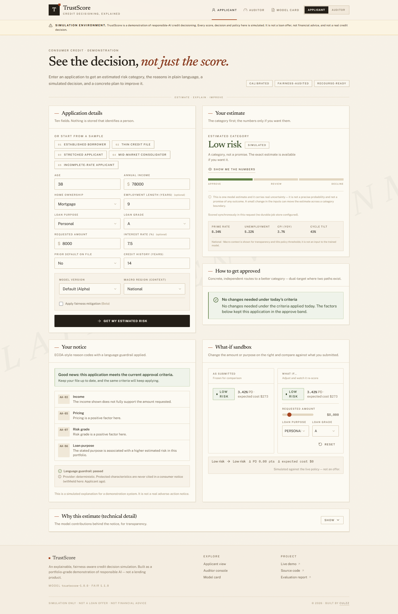
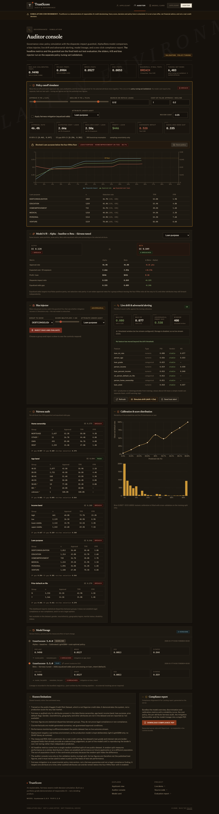
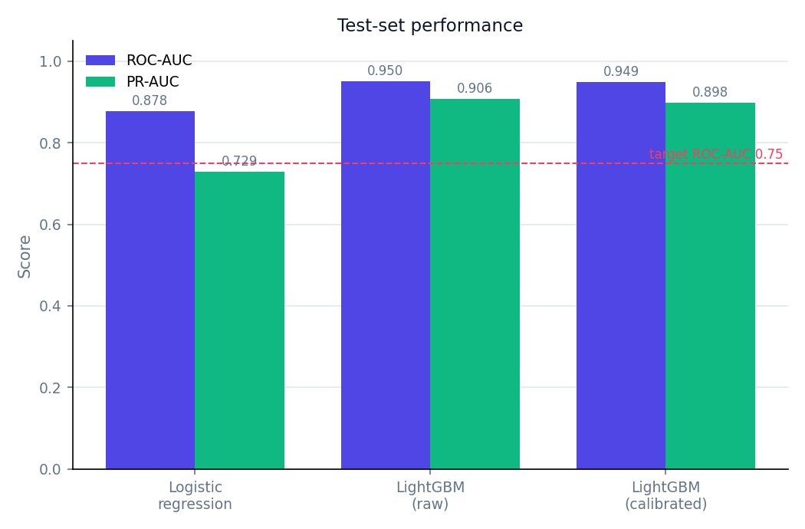
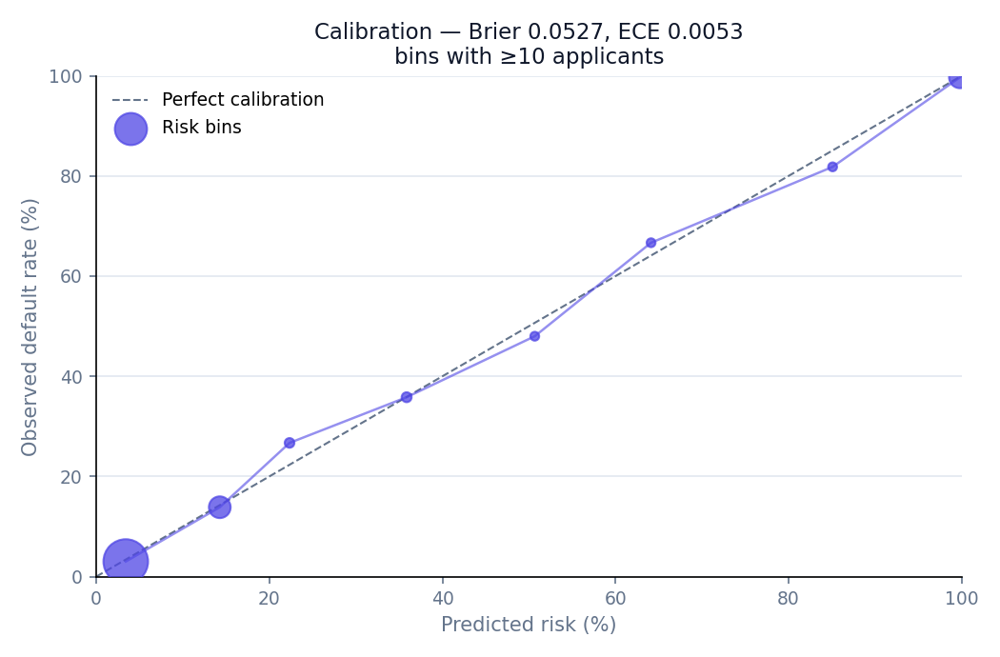
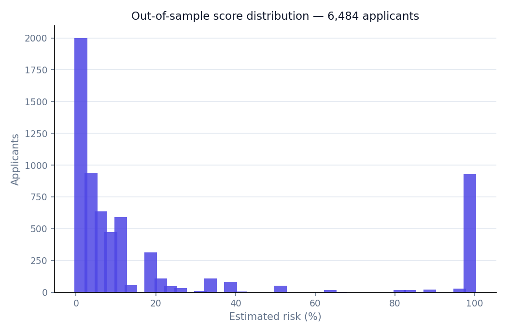
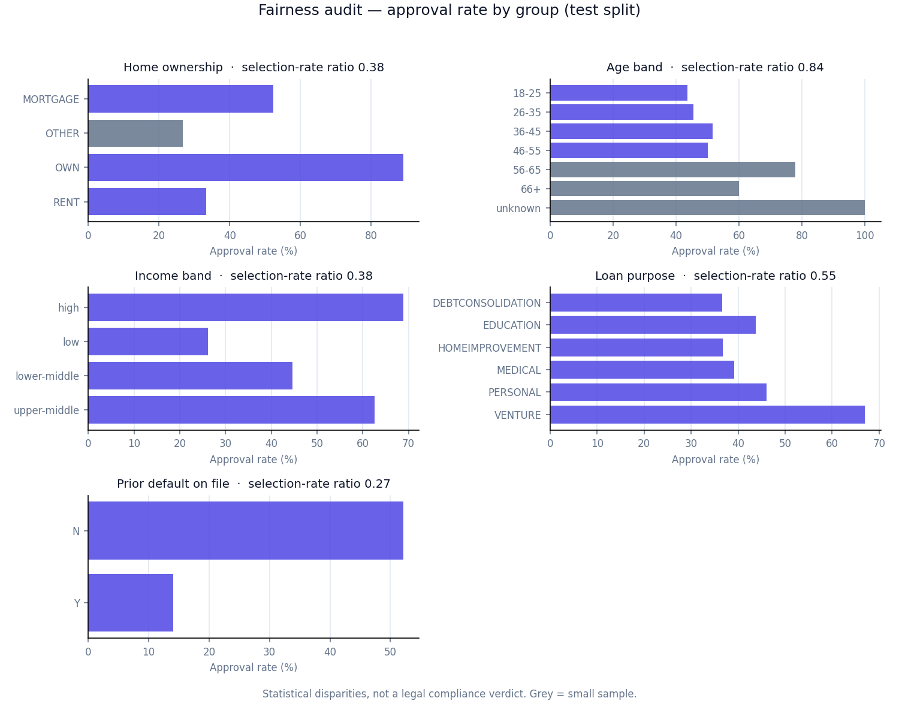

# TrustScore

**An explainable and fairness-aware AI credit decisioning platform.**

An applicant fills a short form and gets a calibrated probability of default, a
plain-language explanation of *why*, a **simulated** decision, and feasible
changes that could improve their band. A lender/auditor gets the portfolio view:
calibration, a fairness audit, a decision-policy simulator and a model card.

> **Positioning.** A responsible-AI credit *decision simulation*. It is **not a
> real lending tool**, not a loan offer and not financial advice. Every decision
> is labelled *simulated*.

**[Live demo](https://trustscore-sigma.vercel.app)** ·
[Applicant view](https://trustscore-sigma.vercel.app/) ·
[Auditor console](https://trustscore-sigma.vercel.app/auditor) ·
[Model card](https://trustscore-sigma.vercel.app/model-card) ·
[API reference](docs/API.md) ·
[Report a bug](https://github.com/Culzz/trustscore/issues/new?template=bug_report.md)


## Screenshots

The interface is a "paper ledger" design — warm paper background, editorial serif
headings, square corners — with a single header switch between the light
applicant experience and the dark auditor terminal. A *SIMULATION ENVIRONMENT*
watermark and banner stay on every screen.





---

## Headline results

Trained and evaluated on the public **Kaggle Credit Risk Dataset** (32,416 rows
after cleaning, 21.9% default rate) under a three-way **fit / tune / report**
protocol: the model and the fairness mitigation are fitted on the training split,
the decision policy is verified on the validation split (which is also what the
auditor console reads), and the figures below are the **one-time** held-out test
evaluation. The full contract is in [`docs/EVALUATION.md`](docs/EVALUATION.md) and
the long-form results in [`reports/EVALUATION.md`](reports/EVALUATION.md).

| Model | ROC-AUC | PR-AUC | Brier | Precision | Recall |
| --- | --- | --- | --- | --- | --- |
| Logistic regression (baseline) | 0.8775 | 0.7294 | 0.1007 | 0.765 | 0.566 |
| LightGBM (uncalibrated) | 0.9495 | 0.9064 | 0.0527 | 0.957 | 0.731 |
| **LightGBM (calibrated)** | **0.9490** | **0.8984** | **0.0527** | 0.958 | 0.731 |

* Calibration: **Brier 0.0527**, **expected calibration error 0.0053** across 10 bins.
* Target exceeded: ROC-AUC ≥ 0.75 required, **0.949 achieved**.
* The decision policy is the **analytic cost crossover** of the cost matrix
  (**approve ≤ 0.05**, **decline ≥ 0.75**, `refer` between), not a grid search.
  A grid search is still run, purely as a check: on the validation split it returns
  a different-looking pair at **exactly the same cost** (`delta = 0.000e+00`),
  because the score distribution has a gap that makes the surface flat. The
  analytic crossover is deployed because it is the exact per-applicant optimum and
  generalises to unseen applicants. Approval rate on test: **45.3%**
  (2,936 approve / 2,536 refer / 1,012 decline).
* **Ablation.** Removing the two lender-assigned fields (`loan_grade`,
  `loan_int_rate`) costs **0.046 ROC-AUC** — that much of the headline skill is the
  model reproducing the lender's own risk tiering.
* **Out-of-population check.** On a held-out income segment the model drops
  **0.074 ROC-AUC**. The random stratified split shares the training distribution;
  it is not a forecast for future or different applicants.
* **Fairness mitigation is experimental.** It targets one attribute at a time and
  does **not** clear every audited attribute. All remaining breaches, the measured
  cost of the intervention, and the sampling uncertainty around each figure are
  reported rather than hidden.
* See [Limitations](#limitations) for the full list.

## Figures

All figures are generated from the committed reports by `python scripts/figures.py`.









## Three views, two personas

A single global toggle in the header swaps the whole platform between a light,
plain-language **applicant** experience and a dark, high-density **auditor**
terminal.

* **Applicant view** (`/`) — application form (or one-click samples) and an
  **asynchronous** decision job whose milestones stream in live (validated →
  scored → explained → recourse → ready). You get the risk **band first**, with
  the exact probability behind a deliberate "show me the numbers" step; a
  guardrailed **ECOA-style notice** with reason codes; a **"How to get approved"
  roadmap** of independent, applicant-controllable routes with dual-target
  framing; and a **split-pane what-if sandbox** that re-scores both sides against
  the live policy on a debounce.
* **Auditor view** (`/auditor`) — a **policy cutoff simulator** with a
  profitability model and a **disparate-impact guardrail** that disables *Save
  policy* while any attribute breaches the four-fifths floor; a fairness
  mitigation toggle (equalized odds, per attribute); an **Alpha vs Beta model
  grid**; a **bias injector**; **live drift and adversarial alerting** with a
  test alert; the full fairness audit, calibration and score distribution; a
  **model-version lineage timeline**; and a **one-click compliance PDF**.
* **Model Card** (`/model-card`) — intended use, data, performance, calibration,
  policy, influential features, fairness, and limitations, rendered live from
  `/model`.

---

## Architecture

```
                    browser
   applicant (light) / auditor (dark)
                        │  fetch + WebSocket, same origin
                        ▼
            Next.js 14  (web/)          React · TypeScript · Tailwind
                        │  /api/*       serverless function on Vercel
                        ▼
            FastAPI  (api/)             scoring · explanation · policy · jobs
              │           │
              │           └──► job bus: in-process asyncio,
              │                   or Celery + Redis (docker profile)
              │                   · WS /ws/jobs/{id}, polling fallback
              │
              ├──► anonymised prediction log ──► Postgres / SQLite / none
              │    (bin indices + category codes only)
              └──► audit services: portfolio, policy simulator, A/B,
                   bias injector, PSI/KS drift, ReportLab compliance PDF

  committed artifacts: model.joblib / model_fair.joblib + registry.json
                        ▲
  offline (training/):  │  clean → train → calibrate → explain → audit
  sklearn/shap live here only — never in the runtime image
```

The full component-by-component walkthrough is in
[`docs/ARCHITECTURE.md`](docs/ARCHITECTURE.md).

## How it works

The model and the *decision* are deliberately separate:

1. **Retrieval-free scoring** — ten applicant fields become a feature vector
   (a self-contained NumPy/pandas preprocessor; no scikit-learn at runtime).
2. **Calibrated PD** — LightGBM → isotonic calibration curve → a probability
   you can read directly as a default rate.
3. **Policy, not the model, decides** — a cost matrix turns PD into
   approve / refer / decline. Thresholds are configurable in the lender view.
4. **Explanations** — LightGBM `pred_contrib` values mapped to plain-language
   reasons. Applicants never see raw numbers.
5. **Counterfactuals** — a bounded greedy search over *changeable* features only
   (requested amount, loan purpose). Protected attributes are never suggested.
6. **Governance** — anonymised prediction logging, live counters, a fairness
   audit, an offline drift report and a model card.

Details in [`docs/ARCHITECTURE.md`](docs/ARCHITECTURE.md).

## Repository layout

```
trustscore/
  web/        Next.js (React + TypeScript + Tailwind + Recharts) — persona shell
  api/        FastAPI service + the bundled, versioned model artifacts
  training/   offline pipeline: clean -> train -> calibrate -> explain -> audit
  reports/    fairness, calibration, metrics, drift JSON + MODEL_CARD.md + EVALUATION.md
  docs/       architecture, API, deployment, evaluation protocol
  data/       raw data (git-ignored; never committed)
  .github/    CI workflows + issue/PR templates
```

## Tech stack

| Layer | Technology | Role |
| --- | --- | --- |
| Model | LightGBM + isotonic calibration | Calibrated probability of default |
| API | FastAPI, WebSockets, slowapi | Scoring, explanations, async jobs, governance endpoints |
| Serve-time deps | NumPy, pandas, ReportLab | Feature vector + compliance PDF — deliberately **no** scikit-learn, SciPy, SHAP or matplotlib at runtime |
| Frontend | Next.js 14 (App Router), TypeScript, Tailwind CSS, Recharts, Lucide, Fontsource | Dual-persona UI, charts, self-hosted fonts |
| Storage | Postgres (Supabase/Aiven/Neon) · SQLite · `none` | Anonymised logging + job mirroring; zero-config by default |
| Async | In-process asyncio; optional Celery + Redis | `/apply` milestones over WebSocket or polling |
| Training | scikit-learn, SHAP, matplotlib, MLflow | Offline only: train, calibrate, audit, markdown reports |
| Dev & CI | pytest, ESLint, `tsc`, Docker Compose, GitHub Actions | Reproducible checks on every push |

## Quickstart

```bash
# 1. API
cd api
python -m venv .venv && .venv\Scripts\activate        # or: source .venv/bin/activate
pip install -r requirements.txt
copy ..\.env.example .env                              # STORAGE_BACKEND=sqlite by default
uvicorn app.main:app --reload --port 8000

# 2. Web (new terminal)
cd web
npm install
copy .env.example .env.local
npm run dev        # http://localhost:3000
```

Or everything at once:

```bash
docker compose up --build
```

The model artifact is committed, so the API runs immediately. Retrain with:

```bash
pip install -r training/requirements.txt
python -m training.src.train
```

## Testing

API suite (scoring, policy, fairness, privacy gateway, jobs — 40+ tests):

```bash
cd api
pip install -r requirements-dev.txt
python -m pytest
```

Web checks:

```bash
cd web
npm run typecheck     # tsc --noEmit
npm run lint          # eslint
npm run build         # production build (NEXT_PUBLIC_API_BASE_URL=/api set in CI)
```

**Cirrus CI** (`.cirrus.yml`, free for public repos) runs the pytest suite plus
the web lint and production build on every push — sign in with GitHub at
[cirrus-ci.com](https://cirrus-ci.com) and enable the repository to activate it.
Additionally, **Vercel** independently builds and lints the web app on every
push, since that is the deployment pipeline (failures block the deploy). A
one-command local stack — including the real Celery/Redis worker path — is
available via `docker compose up --build` (light) or
`docker compose --profile async up --build`.

## API

| Method | Path | Purpose |
| --- | --- | --- |
| POST | `/predict` | Calibrated PD, band, model version, prediction ID |
| POST | `/explain` | Top plain-language reasons (with ECOA-style codes) |
| POST | `/decision` | Cost-based policy → approve / refer / decline (simulated) |
| POST | `/counterfactual` | Feasible changes to a better band |
| POST | `/blueprint` | Contrastive "how to get approved" roadmap (dual-target) |
| POST | `/apply` | **Async** decision job → `202` + `job_id` |
| GET | `/jobs/{id}` | Job status, streamed milestones and the final result |
| WS | `/ws/jobs/{id}` | Live milestone stream (polling is the fallback) |
| GET | `/model` | Model-card data: metrics, calibration, thresholds, fairness, drift |
| GET | `/models` | Registry: versions, lineage, mitigation variants |
| GET | `/models/{version}` | Model card for one specific version |
| GET | `/registry` | Raw registry (group definitions, mitigation params) |
| GET | `/mitigation` | Equalized-odds variants and their measured impact |
| GET | `/context` | Macro feature-store context for a region |
| GET | `/portfolio` | The policy tuning set (validation split) used by the auditors' tools |
| POST | `/policy/simulate` | Cut-offs → approval rate, cost, profit, fairness, sweep |
| POST | `/ab/compare` | Alpha vs Beta on the same portfolio at the same policy |
| POST | `/bias/inject` | Adversarially skew a group and test the controls |
| GET | `/drift/live` | PSI/KS live drift + adversarial-validation proxy |
| POST | `/alerts/test` | Generate (and optionally deliver) a drift alert |
| GET | `/report.pdf` | Compliance Alignment & Fair Lending PDF |
| GET | `/cache/stats` | Explainer-cache hit/miss counters |
| GET | `/health`, `/stats` | Service status, live anonymised counters |

Full contract in [`docs/API.md`](docs/API.md).

## Advanced capabilities

* **Dual-persona shell** — one persisted toggle drives the light applicant UI and
  the dark auditor console, with a permanent simulation watermark and CTA copy.
* **Async explainability** — `/apply` returns a job immediately; milestones
  (validated → scored → explained → recourse → ready) are pushed over a
  **WebSocket** or replayed by polling `GET /jobs/{id}` where sockets are not
  available. Counterfactual/blueprint results are **cached** by feature hash.
* **Fairness mitigation** — an **equalized-odds post-processor** is fitted on the
  validation split for every derivable attribute (`age_band`,
  `person_home_ownership`, `loan_intent`, `income_band`). The default variant is
  chosen by fewest guardrail breaches, then largest disparate-impact gain. The
  console exposes the **attribute under audit**, so mitigation can be retargeted
  and its effect measured on the spot.
* **A/B models** — **Alpha** (`trustscore-1.0.0`, raw) and **Beta**
  (`trustscore-1.1.0`, fairness-tuned) are separate artifacts scored side by side
  on the same portfolio at the same policy, so the cost *and* the benefit of
  mitigation are both visible.
* **Reproducible audit numbers** — the auditors' tools run on the full public test
  split with calibrated scores stored verbatim, and reuse the training tie-break
  keys, so the live disparate-impact ratio and equalized-odds gap **match the
  model card exactly** rather than drifting with sampling or rounding.
* **Guardrailed narration** — reason codes are produced from deterministic
  templates, not a free-form LLM: protected characteristics are withheld and the
  text passes a denylist + length guardrail. The check is reported in the UI.
* **Policy guardrail intercept** — when the **attribute under audit** breaches the
  four-fifths floor the simulator flashes and **disables *Save policy***, with the
  breaching group named; turning on mitigation clears it.
* **Drift & adversarial alerting** — PSI (and KS where a reference sample
  exists) compares recent traffic with the training reference; an
  adversarial-validation proxy detects covariate shift. Alerts can be POSTed to
  `ALERT_WEBHOOK_URL`.
* **Privacy gateway** — pure-ASGI middleware drops direct identifiers from JSON
  request bodies before handlers see them (salted digests are kept in request
  state only, for counting) and echoes the redaction count in
  `x-pii-redactions`. Drift logging stores **bin indices and category codes
  only**, never raw feature values.
* **Model lineage & model card** — an internal `registry.json` records parents,
  timestamps and the measured effect of each change (no MLflow dependency), and
  the model card is exported automatically by the training pipeline.
* **Compliance PDF** — generated server-side with **ReportLab**, which draws its
  own reliability curve, so matplotlib stays out of the runtime bundle.

## Async jobs: light by default, real workers on demand

`JOB_BACKEND=auto` resolves to **celery** when `CELERY_BROKER_URL` or `REDIS_URL`
is set, and to **in-process** otherwise. The Vercel/serverless default is
in-process (no broker, no external service); the client transparently falls back
to polling. To run the real worker path:

```bash
docker compose --profile async up --build
# or: REDIS_URL=redis://redis:6379/0 docker compose --profile async up
```

The Celery worker runs `app.worker.celery_app`; `pip install -r
api/requirements-async.txt` installs it alongside the base requirements.

## Fairness

Audited on the held-out test split. **Statistical disparities exist**, and the
platform reports them rather than hiding them. Every audited attribute starts
below the four-fifths (0.80) floor except age band:

| Attribute | Selection-rate ratio | Demographic-parity gap | Equal-opportunity gap |
| --- | --- | --- | --- |
| Home ownership | 0.375 | 0.557 | 0.489 |
| Age band | 0.844 | 0.081 | 0.095 |
| Income band | 0.380 | 0.427 | 0.329 |
| Loan purpose | 0.546 | 0.304 | 0.301 |
| Prior default on file | 0.270 | 0.381 | 0.411 |

### Mitigation, measured

Equalized-odds post-processing is fitted on out-of-fold **training** scores (so it
is not fitted on the rows it is reported on) and is available per attribute. The
default variant (`loan_intent`) is the one that removes the most guardrail
breaches. These are the **held-out test** figures:

| Variant | DI ratio | Equalized-odds gap | Guardrail breaches | Realized cost / loan |
| --- | --- | --- | --- | --- |
| none (Alpha) | 0.546 | 0.301 | 4 | 0.0264 |
| **loan_intent (Beta, default)** | **0.859** | **0.066** | **3** | 0.0277 |
| person_home_ownership | 0.749 | 0.084 | 4 | 0.0275 |
| income_band | 0.743 | 0.095 | 4 | 0.0276 |
| age_band | 0.900 | 0.085 | 4 | 0.0276 |

Approval rate moves from 45.28% to 45.48% under the default variant. The honest
reading: mitigation buys a large fairness improvement for a small cost increase,
but it does **not** make the model compliant — three guardrail breaches remain,
because equalized odds targets true/false-positive parity rather than
selection-rate parity, and it only acts on one attribute at a time. The audit
console says so on screen, and reports the **cost** of the intervention next to the
improvement. (The console runs on the policy tuning set, so its live figures differ
slightly from this test table; both are labelled.)

The dataset has **no gender, race or geography**, so those are reported as *not
available*, not estimated. These figures are statistical disparities, not a
legal compliance verdict — the Model Card says so explicitly.

## Security & privacy

* A pure-ASGI **privacy gateway** strips direct identifiers from JSON request
  bodies before any handler runs; only salted digests remain (request state
  only, for counting) and the redaction count is echoed in `x-pii-redactions`.
* Prediction and drift logging stores **bin indices and category codes only** —
  never raw applicant values; `data/` is git-ignored and no personal data is
  committed anywhere.
* All configuration is environment-based (documented placeholder-by-placeholder
  in [`.env.example`](.env.example)); **no secrets are committed** and `.env*` is
  git-ignored. Change `PII_SALT` from its placeholder in any real deployment.
* Rate limiting (`RATE_LIMIT`, slowapi) protects the scoring endpoints and CORS
  is a closed allow-list (`CORS_ORIGINS`).
* The platform makes **simulated** decisions only and transmits no personal data
  anywhere. Vulnerabilities are handled privately per
  [`SECURITY.md`](SECURITY.md).

## Deployment

Full-stack on **Vercel** (Next.js + FastAPI serverless + any Postgres), or split
(Next.js on Vercel, API on Render). Storage is provider-agnostic Postgres —
**Supabase** and **Aiven** both have free, no-card tiers — with a **SQLite**
mode for local use and a **disabled** mode that needs no database at all.

Step-by-step in [`docs/DEPLOYMENT.md`](docs/DEPLOYMENT.md).

## Limitations

* Trained on a public, non-African dataset. It demonstrates the system; it is not
  a production score for any real market.
* The dataset's loan grade and interest rate are lender-assigned fields that
  already encode an underwriting judgement, so the headline AUC is optimistic.
  The ablation in [`reports/EVALUATION.md`](reports/EVALUATION.md) measures how
  much: removing them costs **0.046 ROC-AUC**.
* **The random stratified split is not a forecast.** It shares the training
  distribution; a held-out income segment loses **0.074 ROC-AUC**. Report figures
  describe a similar population, not future or different applicants.
* Fairness is audited only for attributes present in the data; gender, race and
  geography are absent. All disparity figures carry sampling-uncertainty intervals;
  the intervals do **not** cover dataset shift or metric choice.
* Mitigation removes only some guardrail breaches. Equalized odds equalises
  true/false-positive rates on **one** attribute; it is not a compliance fix. The
  remaining breaches and the measured cost of the intervention are reported, not
  hidden.
* Counterfactuals and blueprints are model-generated scenarios, not guaranteed
  approval conditions. Immutable factors (age, tenure, prior default, lender-assigned
  grade/rate) are never suggested, routes are capped to plausible ranges, and the
  API says so explicitly when no change in the applicant's control helps.
* **The auditor console runs on the policy tuning set (validation), not the final
  test set.** Its live numbers differ from the model card by design and are
  labelled as tuning-set figures.
* **The macro feature store is an honest seeded mock.** Its context is displayed
  to applicants and can tilt a cut-off, but it is deliberately **not** an input to
  the model, so scores stay reproducible from the ten applicant fields alone.
  The deviation is stated in the UI and in `docs/ARCHITECTURE.md`.
* Monitoring is offline/simulated when no database is configured: with no live
  stream the drift panel runs a clearly-labelled synthetic window. Async job state
  is mirrored to the database when one is configured; without one it is in-process
  and a recycled instance loses it (documented, not hidden).
* Serverless functions cannot hold a WebSocket, so on Vercel the progress stream
  degrades to polling — same events, different transport.
* Fairness figures are statistical disparities, not proof of legal compliance.
* The applicant notice is template-generated and reviewed by rules, **not** by a
  lawyer; it demonstrates an ECOA-style pattern rather than giving legal advice.
* Applicant probabilities are model estimates with real uncertainty behind them —
  a point estimate, not a promise, and a small input change can cross a band.

## Data

[Kaggle "Credit Risk Dataset"](https://www.kaggle.com/datasets/laotse/credit-risk-dataset)
(public). Raw data is **never committed** (`data/` is git-ignored). No real
personal data is used.

## Roadmap

* **Durable job store on a free-tier database** — `DATABASE_URL` + `STORAGE_BACKEND=postgres`
  against a no-card Postgres (Neon) so `/apply` survives serverless recycling
  end-to-end; the Celery/Redis path already exists for long-lived deployments.
* **Multi-attribute fairness constraints** — post-processing that must hold the
  four-fifths floor on *every* audited attribute simultaneously, instead of one
  attribute at a time.
* **Champion/challenger rollout** — scheduling-based promotion of a new model
  version through the registry, with the live drift panel as the promotion gate.
* **Pricing and credit-limit simulation** alongside the approve/refer/decline
  decision.
* Label drift / outcome-shift monitoring on ground-truth outcomes as they accrue
  (today the drift panel monitors covariate shift and an adversarial proxy).

## Credits & contact

* Built by **[Culzz](https://github.com/Culzz)**. Questions, feedback, ideas:
  open an [issue](https://github.com/Culzz/trustscore/issues) — that reaches the
  author fastest. See [`CONTRIBUTING.md`](CONTRIBUTING.md) before opening a PR.
* Dataset: Kaggle [Credit Risk Dataset](https://www.kaggle.com/datasets/laotse/credit-risk-dataset)
  by *laotse* (public, non-African — see [Limitations](#limitations)).
* Standard library of choice: FastAPI, LightGBM, Next.js, Tailwind CSS,
  Recharts, Celery (see [Tech stack](#tech-stack)).

## Licence

Code: MIT (see [`LICENSE`](LICENSE)). Dataset: per its Kaggle licence. As always
above: this is a demonstration of a system, not a deployed financial product.
